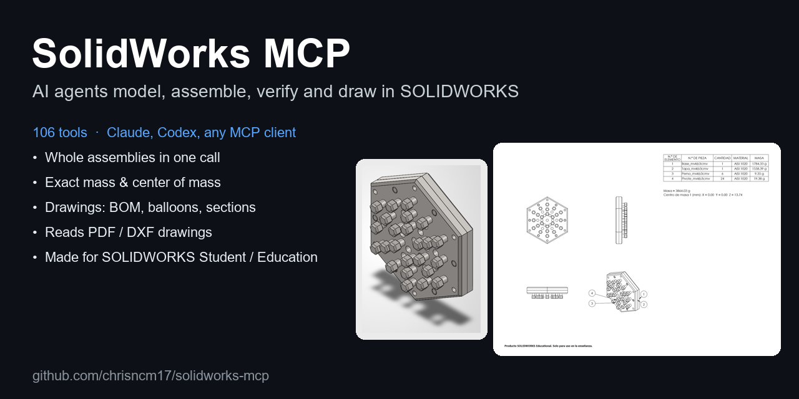
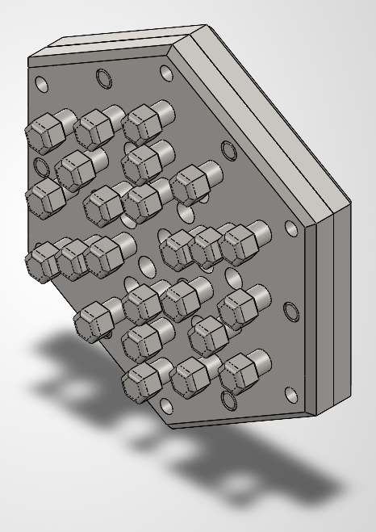
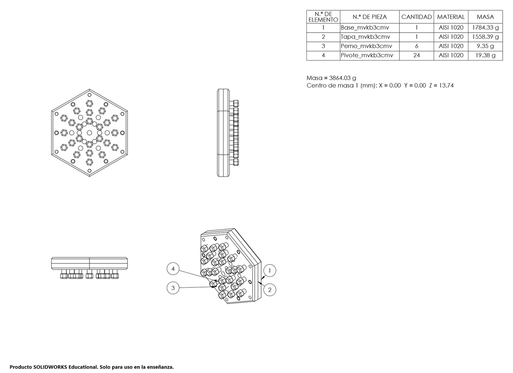
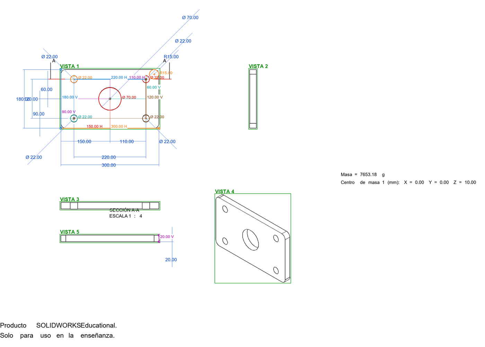
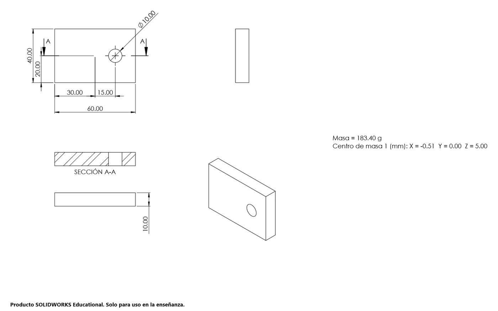
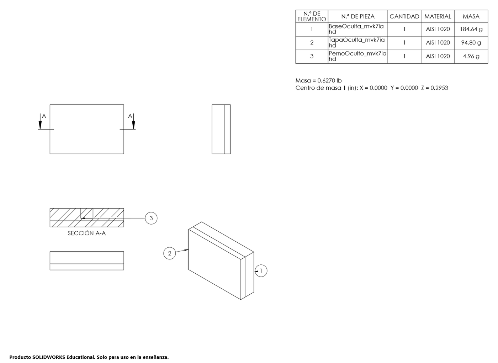
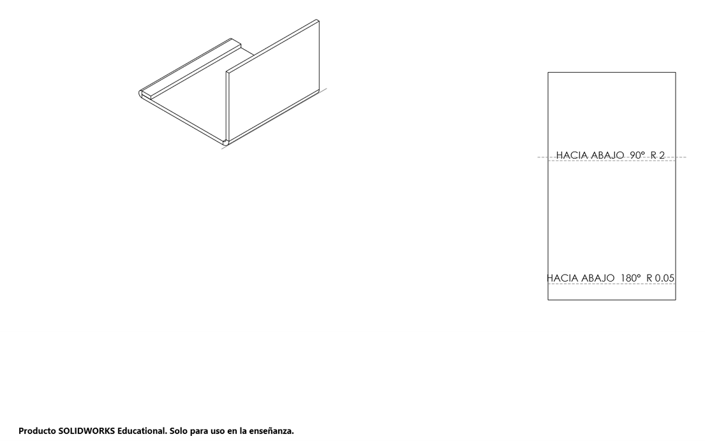

# SolidWorks MCP



**Let an AI agent model, assemble, verify and draw in SolidWorks.** A [Model Context Protocol](https://modelcontextprotocol.io) server for SolidWorks on Windows with 106 tools: parts from a short recipe, whole assemblies in one call, exact mass and center of mass, drawings with BOM, balloons and section views, and reading of PDF/DXF drawings - all with backups and verified rollback so your own files are never broken.

Works with **Claude Desktop, Claude Code, OpenAI Codex (CLI / IDE)** and any MCP client that can launch a local (stdio) server.

> **Made for SOLIDWORKS Student / Education editions** (e.g. *3DEXPERIENCE SOLIDWORKS for Students*). It covers what those editions do well and what engineering courses grade: parts, assemblies, mates, mass properties, drawings, sheet metal and file exchange. It does **not** drive SOLIDWORKS Simulation, Flow Simulation, Motion studies, PDM, Routing or other Professional/Premium add-ins - if you have them, contributions are very welcome. Drawings made with an educational license keep its watermark.

[Español](README.es.md) · [Install](docs/INSTALL.md) · [All tools and options](docs/TOOLS.md) · [Architecture](docs/ARCHITECTURE.md) · [Changelog](CHANGELOG.md)

 

*A pegboard with 32 components (4 parts generated from their recipes, 6 bolts, 24 pivots from a circular pattern, 23 mates) built, verified and drawn by **one** `sw_assembly_build` call: mass 3864.0278 g and center of mass (0, 0, 13.7356) mm ready in about 2-3 minutes from scratch on a laptop, including starting SolidWorks; about 75 s when the parts already exist.*

## What it can do

| Area | Highlights |
|---|---|
| **Parts** | `sw_part_build`: a part described as a small JSON recipe (`part-ir/1`: sketches with `rect`, `polar`, `grid`, `steps`; extrude, cut, revolve, sweep, fillet, chamfer, Hole Wizard, shell, rib, patterns...) is built, then checked against the expected box, volume or mass, with a hint of what is wrong when it does not match. 40+ single-feature tools too. |
| **Assemblies** | `sw_assembly_build`: the whole assembly in one call - parts, mates by *intent* (`insert`, `face_to_face`, `flush`, `fastener`), faces described like the drawing says them (`cylinder Ø8`, `plane normal +Z`), generated ISO bolts/washers/nuts, component patterns, coordinate systems found from the drawing's CM values, then mates, interferences, mass and CM are verified. Failures name the suspect mate. |
| **Verification** | `sw_mass_check`, `sw_assembly_doctor`, `sw_interference`, `sw_collision`, `sw_part_diff`, `sw_assembly_diff`, `sw_answer_sheet` (mass and every CM in the units you need). |
| **Drawings** | `sw_assembly_drawing`: views, standard scale, BOM with material and mass, balloons, answer note and PDF in one call; **section views** through a model point, added automatically for hidden parts; flat-pattern views; title block copied from another drawing. |
| **Reading drawings** | `sw_drawing_read`: from a PDF exported by SolidWorks it finds the views and, for every dimension, **the two points of the part it measures**; radii, diameters and angles with their centre/vertex; title-block material; scale per view. From a **DXF** every dimension is exact (definition points x DIMLFAC). Phone photos get enhanced tiles. |
| **Sheet metal** | Base flange, edge flange, sketched bend, hem, flatten, flat-pattern DXF/DWG and drawing view. |
| **Exchange** | Import STEP / IGES / Parasolid / ACIS (`sw_import_model`, always from a copy), export STEP, IGES, x_t, STL, PDF, DXF, DWG one by one or in batches, Pack and Go. |
| **Safety** | Only files it created or user files opened with an automatic backup are edited; every edit is health-checked and **rolled back automatically** if it breaks something; saving is blocked after an unverified restore; with `sw_exam_ready` / `sw_instance start` the MCP works in its own minimized SolidWorks, separate from the one you are using. |



<sub>Above: `sw_drawing_read action: dimensions` on a DXF - each dimension drawn between the two points it measures, views boxed and numbered.</sub>

| Section view through a hole | Hidden pin gets a section + balloon automatically | Sheet metal: sketched bend, hem and flat pattern |
|---|---|---|
|  |  |  |

## Quick start

Requirements: Windows 10/11, SolidWorks (tested on SolidWorks 2026 in Spanish; English plane and view names are handled too), Node.js 18+, Python 3.11+ with `pypdf` and `Pillow` (only for reading drawings).

```powershell
git clone https://github.com/chrisncm17/solidworks-mcp.git
cd solidworks-mcp
npm install
npm run build        # compiles the C# worker against your SolidWorks API
npm test             # 112 offline tests, no SolidWorks needed
```

Then register the server in your client - full details in [docs/INSTALL.md](docs/INSTALL.md):

```json
{ "mcpServers": { "solidworks": { "command": "node", "args": ["C:\\path\\to\\solidworks-mcp\\server\\server.mjs"] } } }
```

Ask your agent: *"Start SolidWorks with sw_exam_ready, then build a 100 x 60 x 10 mm AISI 1020 plate with four Ø8 holes 10 mm from the corners and tell me its mass."*

## All tools

<!-- tools:start -->
**106 tools.** Every option of every tool: [docs/TOOLS.md](docs/TOOLS.md).

<details><summary><b>Session and documents</b> (20)</summary>

| Tool | What it does |
|---|---|
| `sw_checkpoint` | Save current managed document as a NEW native backup with matching extension, without changing active filename. |
| `sw_close_document` | Close a document opened in this MCP session. |
| `sw_configuration` | List the configurations of a managed part/assembly (action list) or activate one (action activate, name) and rebuild; |
| `sw_copy_renamed` | Copy a SAVED assembly, drawing or part plus every file it references into generated\copies\<folder_name>, adding prefix (default copia_) to every file name, and re-link t… |
| `sw_create_assembly` | Create a native assembly from saved managed parts. |
| `sw_create_part` | Create and save an empty native SLDPRT using an existing absolute PRTDOT template. |
| `sw_document_units` | Units saved IN the part/assembly for Calcular > Propiedades fisicas with "Utilizar configuraciones de documento": action get, or set mass_length (default in), mass (defau… |
| `sw_environment` | Discover installed part templates, material databases, thread profile types and exact sizes, and managed filenames. |
| `sw_exam_ready` | Exam day check in one call, before anything else: MCP version and tool count (if this tool is missing from the chat, the app has an old MCP loaded: restart Claude Desktop… |
| `sw_import_model` | Import a STEP, IGES, Parasolid (x_t/x_b) or ACIS (sat) file as a NEW managed part (name .SLDPRT) or assembly (name .SLDASM, its parts are saved next to it). |
| `sw_instance` | One SolidWorks for the user, one for the MCP. |
| `sw_open_copy` | Copy a saved SLDPRT into the managed folder and open the copy for editing. |
| `sw_open_project` | Open a USER part, assembly or drawing in place (outside generated) after an AUTOMATIC BACKUP of the file and every referenced file into generated/backups/<timestamp>_<nam… |
| `sw_restore_backup` | List backups made by sw_open_project (action=list) or restore one (action=restore, backup_name): copies every backed-up file back to its original path. |
| `sw_resume_copy` | Reopen a named SLDPRT from the managed generated folder of this server. |
| `sw_resume_document` | Resume an existing managed native part, assembly or drawing by filename. |
| `sw_save` | allow_errors: save anyway, reporting the problems; |
| `sw_save_body` | Save ONE solid body of a multibody managed part as a NEW managed part (Guardar cuerpo): pick it with point_mm (a point ON a face of that body, part coordinates) or body_i… |
| `sw_session_health` | Why SolidWorks feels slow: RAM used by SolidWorks and free system RAM, open documents (visible, hidden, unsaved, owned by this MCP session, in use) and hints. |
| `sw_status` | Check connection to an already-open SolidWorks in this Windows user session. |

</details>

<details><summary><b>Part modeling</b> (39)</summary>

| Tool | What it does |
|---|---|
| `sw_chamfer` | Keeps the SolidWorks default tree name (features are never renamed); |
| `sw_circular_pattern` | Keeps the SolidWorks default tree name (features are never renamed); |
| `sw_create_cylinder` | Create and save a new native parametric cylinder. |
| `sw_create_sketch` | Keeps the SolidWorks default tree name (features are never renamed); |
| `sw_cut` | Keeps the SolidWorks default tree name (features are never renamed); |
| `sw_delete_feature` | Delete a named feature and its absorbed sketch from a managed part (for example a failed attempt), so the FeatureManager tree stays clean. |
| `sw_delete_relation` | Delete one inspected sketch relation on a managed copy. |
| `sw_draft` | Keeps the SolidWorks default tree name (features are never renamed); |
| `sw_equations` | Read equations and global variables from the ACTIVE document, including unsaved parts and active sketches. |
| `sw_extrude` | Keeps the SolidWorks default tree name (features are never renamed); |
| `sw_extrude_edit` | Change an EXISTING extrusion (boss or cut) without redrawing it: end_condition of direction 1 (blind, mid_plane, through_all), depth_mm and/or reverse. |
| `sw_fillet` | Keeps the SolidWorks default tree name (features are never renamed); |
| `sw_helix` | Keeps the SolidWorks default tree name (features are never renamed); |
| `sw_hole_wizard` | Keeps the SolidWorks default tree name (features are never renamed); |
| `sw_linear_pattern` | Keeps the SolidWorks default tree name (features are never renamed); |
| `sw_loft` | Keeps the SolidWorks default tree name (features are never renamed); |
| `sw_mirror` | Keeps the SolidWorks default tree name (features are never renamed); |
| `sw_move_body` | Mover/Copiar solido: fixes a part modeled on the wrong plane (origin or axes not as in the drawing) WITHOUT redrawing it. |
| `sw_parameters` | Managed parts only. list is read-only; |
| `sw_part_build` | Build an EDITABLE part from a part IR (part-ir/1): named params (numbers) and expressions (+ - * / ^ ( ) pi sqrt sin cos tan) in features extrude\|cut\|revolve (sketch on f… |
| `sw_part_flex` | Managed parts only. Temporarily perturb driving sketch/feature dimensions by pct (default 0.05, fraction) or absolute delta_mm for lengths; |
| `sw_radius_dimension` | Add an explicit driving radius dimension to a current arc segment in a managed sketch. |
| `sw_ref_axis` | Keeps the SolidWorks default tree name (features are never renamed); |
| `sw_ref_plane` | Keeps the SolidWorks default tree name (features are never renamed); |
| `sw_ref_plane_advanced` | Keeps the SolidWorks default tree name (features are never renamed); |
| `sw_relations` | Read sketch constraints and status: 2 underdefined, 3 fully defined, 4 overdefined, 5 no solution, 6 invalid. |
| `sw_revolve` | Keeps the SolidWorks default tree name (features are never renamed); |
| `sw_rib` | Keeps the SolidWorks default tree name (features are never renamed); |
| `sw_scale_uniform` | Uniformly scale a managed copy. |
| `sw_set_dimension` | Set a named dimension on a managed copy and rebuild. |
| `sw_set_material` | Assign a SolidWorks library material, written as in the drawing in Spanish or English (Hierro dúctil / Ductile Iron, Caucho / Rubber, AISI 304, Oro puro / Pure Gold, AISI… |
| `sw_sheet_metal` | Chapa metálica on a managed part. |
| `sw_shell` | Keeps the SolidWorks default tree name (features are never renamed); |
| `sw_sketch` | Read sketch segments, their current indexes, coordinates in meters and relation types. |
| `sw_sketch_plane` | Move an existing sketch onto another planar support (Editar plano de croquis) without redrawing it: face_of_sketch (the face/plane another sketch sits on), plane (referen… |
| `sw_suppress_feature` | Suppress or unsuppress a named feature in the active configuration of a managed part and rebuild. |
| `sw_sweep` | Keeps the SolidWorks default tree name (features are never renamed); |
| `sw_tangent` | Add a relation between two current sketch segment indexes; |
| `sw_thread` | Keeps the SolidWorks default tree name (features are never renamed); |

</details>

<details><summary><b>Assemblies</b> (25)</summary>

| Tool | What it does |
|---|---|
| `sw_add_mate` | Add a mate (relación): coincident, concentric, distance (distance_mm), parallel, perpendicular, angle (angle_deg), symmetric (3 entities: 2 + plane), width (4 entities), … |
| `sw_assembly_batch` | Low-level batch used by sw_assembly_build: insert components [{id,path,fixed,position_mm\|transform,configuration}] and add mates [{name,type,entities (component = plan id… |
| `sw_assembly_build` | Batch assembly compiler. |
| `sw_assembly_diff` | READ-ONLY: compare two SAVED assemblies (path = yours, reference_path = e.g. |
| `sw_assembly_doctor` | Read-only assembly diagnosis: missing references, mate errors, duplicate candidates and remaining component movements. |
| `sw_assembly_draft` | No SolidWorks: from an assembly drawing (PDF, via analyze) and the folder of parts, a plan skeleton for sw_assembly_build: components with file and count from the parts t… |
| `sw_assembly_drawing` | Drawing of an assembly or of a PART in ONE call (a part gets no BOM or balloons but its model dimensions, center marks and hole callouts on the three views; |
| `sw_assembly_export` | Read-only export of an open managed assembly as assembly-ir/1, also written to generated/assembly_ir/<name>.json. |
| `sw_assembly_new` | Create and save a NEW empty assembly at an absolute .SLDASM path (folder must exist; |
| `sw_assembly_repair` | Repair an assembly WITHOUT losing its intended pose. |
| `sw_collision` | Collision detection (detección de colisiones) on a managed assembly: drive an existing DISTANCE or ANGLE mate (create it first with sw_add_mate on the free degree of free… |
| `sw_component_pattern` | Pattern TOP-LEVEL assembly components (patrón de componentes). |
| `sw_component_solving` | Make a TOP-LEVEL, resolved SUBASSEMBLY component flexible (its own mates solve in the top assembly, so its parts can move — e.g. |
| `sw_coordinate_system` | kind circle_center puts the origin at the centre of the circular edge (hole) through local_point_mm; |
| `sw_delete_mate` | Delete assembly mates by exact name (from sw_mates list) and verify they are gone. |
| `sw_edit_mate` | Edit an existing assembly mate WITHOUT deleting it: distance_mm (distance mate), angle_deg (angle mate), flip_dimension (side of a distance/angle), align aligned\|anti_ali… |
| `sw_explode` | Exploded view (vista explosionada) of the active configuration of a managed assembly. |
| `sw_find_faces` | Read-only: faces of an assembly component described like the drawing says, instead of a point: kind cylinder (diameter_mm, axis) or plane (normal outward, offset_mm), nea… |
| `sw_find_origin` | The drawing gives a center of mass but not where its origin is nor how its axes point: tries every component origin and every hole/shaft axis point with the 24 axis-align… |
| `sw_insert_component` | Insert a part or subassembly (absolute path) into an assembly with its ORIGIN at position_mm (default 0,0,0, no rotation; |
| `sw_interference` | Detect interferences in a managed ASSEMBLY: count, total volume mm^3 and component pairs. |
| `sw_mass_override` | Override the mass (and optionally the center of mass, in mm in this document coordinates) of a part or assembly, ONLY when the drawing specifies it (e.g. |
| `sw_mates` | Managed ASSEMBLY mates. |
| `sw_move_component` | Place an UNDER-DEFINED assembly component: its origin at position_mm and rotation rotation_deg [rx,ry,rz] (world X then Y then Z), or axes = the component X,Y,Z unit axes… |
| `sw_replace_component` | Replace a TOP-LEVEL component of a managed assembly with another file of the same kind (part→part, assembly→assembly), keeping and re-attaching its mates; |

</details>

<details><summary><b>Drawings and reading drawings</b> (11)</summary>

| Tool | What it does |
|---|---|
| `sw_answer_sheet` | Exam answers ready to copy: total mass and the center of mass in EVERY coordinate system of the model (default all, in tree order Sistema de coordenadas1, 2...; |
| `sw_balloons` | Automatic balloons (globos) with BOM item numbers on the assembly views of a managed drawing (views, default all assembly views of the active sheet), layout square\|circle… |
| `sw_bom` | Bill of materials (lista de materiales / BOM) on a managed DRAWING. |
| `sw_create_drawing` | Create a native drawing with three standard orthographic views of a SAVED managed part/assembly using a DRWDOT template. |
| `sw_drawing_annotate` | Add the MODEL dimensions to drawing views (Insert Model Items: dimensions marked for drawing; |
| `sw_drawing_new` | Low-level, used by sw_assembly_drawing: empty drawing from a DRWDOT template with a width_mm x height_mm sheet, saved at an absolute path inside generated/drawings (never… |
| `sw_drawing_note` | Text notes on the active (or named) sheet of a managed drawing, not attached to a view: one note per line in lines, top-left at position_mm [x,y] from the sheet bottom-le… |
| `sw_drawing_read` | action dimensions (PDF exported by SolidWorks, one page): for every linear dimension its direction (horizontal, vertical), its view (found from the geometry, no labels ne… |
| `sw_drawing_sheets` | Sheets of a managed DRAWING. |
| `sw_drawing_views` | DRAWING sheets and views. |
| `sw_measure_sheet` | Measurement sheet (ficha de medidas) of ONE part read from a drawing. |

</details>

<details><summary><b>Verification, export and delivery</b> (11)</summary>

| Tool | What it does |
|---|---|
| `sw_compare_volume` | Compare measured solid volume against a positive target in mm^3 with an explicitly supplied tolerance percent. |
| `sw_export` | Export complete managed part/assembly to NEW STEP, STL, Parasolid or IGES, or drawing to PDF, DXF or DWG, in generated (sheet metal flat patterns: sw_sheet_metal export_f… |
| `sw_export_batch` | Export several documents to several formats in ONE call: every document_id in document_ids to every format in formats (parts/assemblies: step, stl, x_t, igs; |
| `sw_feature_info` | Read-only definition of one feature to understand a warning/error the API only reports as a code: type, error/warning, suppression, parents and children; |
| `sw_geometry` | Read faces, edges, circular radii and bounding boxes of a managed solid. |
| `sw_inspect` | Inspect managed document. |
| `sw_mass_check` | READ-ONLY mass and center-of-mass verification of a part or assembly (exam check: masa y centro de masa X,Y,Z). |
| `sw_pack_and_go` | Pack and Go a SAVED managed assembly or drawing into generated/packs/<folder_name> (flattened, includes referenced parts), then verify that every referenced file exists i… |
| `sw_part_diff` | Read-only comparison of a managed PART against an original .SLDPRT (absolute path, opened read-only through a temporary copy): volume, mass, material, solid body count, s… |
| `sw_preview` | Create an isometric PNG preview of a managed part/assembly or fit the current drawing sheet. |
| `sw_topology` | Inspect faces and unique edges with short-lived selection references. |

</details>

<!-- tools:end -->

## How it works

```
MCP client (Claude / Codex / ...)
   │  stdio, JSON-RPC
server/server.mjs ── tools.mjs (106 JSON schemas + cross-checks), recipes (MCP resources)
   │  high-level tools in JS: part_ir, assembly_build, assembly_drawing, drawing_read (+ Python PDF/DXF helpers)
   │  one JSON line per call
server/Worker-equations.exe  (C#, STA, SolidWorks COM API) ── safe-edit guard: health check, rollback, backups
   │
SolidWorks (its own minimized instance, or yours on request)
```

More in [docs/ARCHITECTURE.md](docs/ARCHITECTURE.md). Agents also get **recipes** (MCP resources in `server/recipes/*.md`) with the proven way to do common jobs, and two optional Claude Code sub-agents in `agents/` (one reads a drawing and writes the part recipe without SolidWorks, one checks your own part against the drawing without touching it).

## Examples

`examples/` has runnable scripts that drive the worker directly (they start the MCP's own SolidWorks): the pegboard in one call, a roller conveyor with patterns and reverse checks, a swivel caster, section views, automatic section + balloon, import/export round trip with identical mass, sheet metal, and the full MCP protocol flow. See [examples/README.md](examples/README.md).

## Status and limits

- Windows only (SolidWorks is Windows only). Tested with SOLIDWORKS 2026 Education/Student edition (Spanish UI); the API calls used exist since roughly SolidWorks 2018 but older versions are untested.
- No Simulation / Flow / Motion / PDM / Routing (not part of the student scope this was built for).
- Some messages and notes are in Spanish (the project started as a mechanical-engineering student's exam helper); tool schemas and descriptions are in English.
- Long calls (whole assemblies) take minutes: raise your client's tool timeout (see INSTALL).
- ChatGPT (web/desktop) only accepts remote MCP servers over HTTPS, so this local server does not plug into it directly.

## Contributing

New tools, fixes and recipes are welcome - see [CONTRIBUTING.md](CONTRIBUTING.md) for how the pieces fit, how to add a tool and how releases are cut.

## License

[MIT](LICENSE). SolidWorks is a trademark of Dassault Systèmes; this project is not affiliated with or endorsed by Dassault Systèmes. You need your own SolidWorks license.
